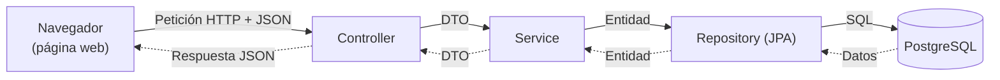
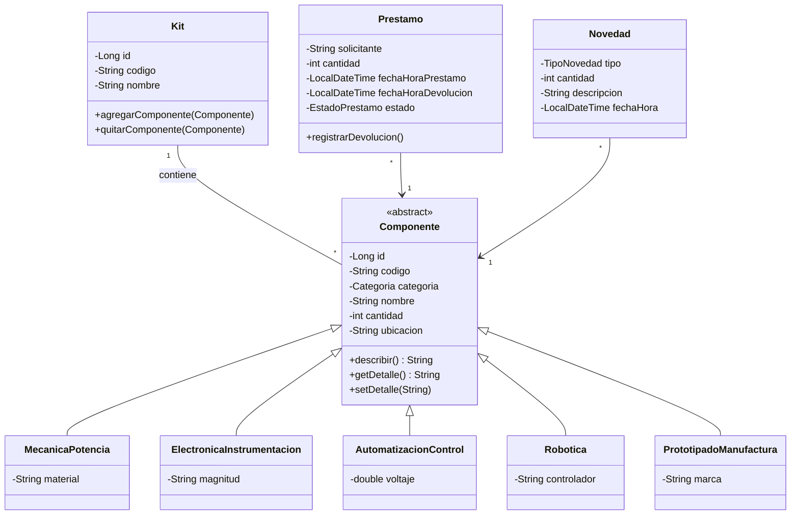

# Inventario del Laboratorio de Mecatrónica

Proyecto final de **Programación y Diseño Orientado a Objetos** (CORHUILA, 2026-B).
Aplicación web hecha con **Spring Boot, JPA y PostgreSQL**.

**Autor:** Sofía Isabel Mendoza Muñoz

---

## 1. Problema

En un laboratorio de mecatrónica hay elementos de muy distinta naturaleza: componentes electrónicos, piezas mecánicas, equipos de automatización, robots, máquinas de prototipado y hasta licencias de software. Sin un registro ordenado es difícil saber **qué hay, cuántas unidades quedan, dónde está cada cosa, quién la tiene prestada y qué se dañó o se extravió**.

Este proyecto es una **aplicación web** que permite llevar ese inventario desde el navegador:

- Registrar, consultar, actualizar y eliminar componentes (**CRUD**) en **cinco categorías**, con **código generado automáticamente**.
- Agrupar componentes en **kits** de práctica.
- Registrar **préstamos** con fecha y hora de salida y de devolución.
- Registrar **novedades** (componente dañado, extraviado o fuera de servicio).
- **Buscar y filtrar** el inventario, con **paginación**.
- Guardar todo en **PostgreSQL** a través de **JPA**.

## 2. Tecnologías

| Tecnología | Uso |
|---|---|
| Java 25 | Lenguaje |
| Spring Boot 4 (Web MVC, Data JPA, Validation) | Framework del servidor y de la API |
| JPA / Hibernate | Mapeo de las clases a tablas |
| PostgreSQL | Base de datos |
| HTML, CSS y JavaScript | Página web (cliente) |
| Maven (wrapper incluido) | Construcción del proyecto |
| Postman | Pruebas de la API |
| IntelliJ IDEA | IDE |

## 3. Cómo funciona (la ruta de una petición)

El usuario interactúa con la página; la página envía **peticiones HTTP** al servidor, y el servidor responde con datos en **JSON**.



Ejemplo, al pulsar **"Crear componente"**:

1. La página arma un JSON con los datos del formulario y envía un `POST /api/componentes` (con `fetch`).
2. El **controlador** (`ComponenteController`) lo recibe como un `ComponenteDTO`.
3. El **servicio** (`ComponenteService`) lo convierte a entidad con el mapeador (aquí se **validan** los datos), **genera el código** y llama al repositorio.
4. El **repositorio** (`ComponenteRepository`, JPA) guarda la entidad en PostgreSQL.
5. La respuesta vuelve convertida en DTO y JSON, y la página actualiza la tabla.

## 4. Diseño

### 4.1 Arquitectura por capas

```
com.corhuila.proyecto
 ├── model        -> entidades del dominio (encapsuladas)
 ├── dto          -> objetos de transferencia de datos
 ├── mapper       -> conversión entre entidades y DTO
 ├── repository   -> acceso a datos con JPA (PostgreSQL)
 ├── service      -> lógica de negocio y reglas
 ├── controller   -> endpoints HTTP (GET, POST, PUT, DELETE)
 ├── exception    -> excepciones propias y su manejo
 └── config       -> carga de datos de ejemplo

src/main/resources/static/index.html      -> la página web
src/main/resources/application.properties -> configuración y conexión a la base de datos
```

Cada capa tiene una sola responsabilidad: el **controlador** recibe la petición, el **servicio** aplica las reglas y el **repositorio** se comunica con la base de datos. Así, cambiar la forma de guardar los datos no obliga a tocar el modelo ni los controladores.

### 4.2 ¿Por qué un DTO?

El **DTO** (*Data Transfer Object*) es una clase que solo transporta datos entre el navegador, el controlador y el servicio. Se usa para no exponer directamente las entidades de la base de datos: la API muestra solo los campos definidos y un cambio en una tabla no cambia automáticamente lo que ve el cliente. La conversión entre DTO y entidad se concentra en los mapeadores.

### 4.3 Diagrama de clases



### 4.4 Categorías

Cada categoría es una clase hija de `Componente` con un dato propio, y su prefijo se usa para generar el código automático.

| Categoría | Clase | Prefijo | Dato propio | Ejemplos |
|---|---|---|---|---|
| Mecánica y sistemas de potencia | `MecanicaPotencia` | `MEC` | Material | Engranajes, rodamientos, cilindro neumático |
| Electrónica e instrumentación | `ElectronicaInstrumentacion` | `ELE` | Magnitud que mide o maneja | Multímetro, osciloscopio, sensores |
| Automatización y control | `AutomatizacionControl` | `AUT` | Voltaje de operación (V) | PLC, relés, contactor, HMI |
| Robótica | `Robotica` | `ROB` | Controlador compatible | Brazo robótico, servos, chasis 4WD |
| Prototipado, manufactura y software | `PrototipadoManufactura` | `PRO` | Marca o proveedor | Impresora 3D, fresadora CNC, licencias |

La primera vez que arranca (con la base de datos vacía) se cargan **35 componentes de ejemplo, 7 por categoría**.

### 4.5 Reglas de negocio

- **Código automático:** el operario no lo escribe. El servicio toma el último componente de la categoría, le suma uno y arma el código con el prefijo (`MEC-001`, `ROB-002`...). Los kits siguen el mismo mecanismo (`KIT-001`).
- **Préstamos:** la fecha y hora de salida las registra el sistema. Prestar **descuenta** las unidades del inventario y registrar la devolución las **repone**. No se puede prestar más de lo disponible, ni devolver dos veces el mismo préstamo.
- **Novedades:** un componente dañado, extraviado o fuera de servicio se registra con descripción, fecha y hora, y **descuenta** esas unidades del inventario disponible.
- **Transacciones:** el préstamo y el descuento del inventario se guardan juntos (`@Transactional`): o se hacen ambos o ninguno.
- **Bajo stock:** un componente con menos unidades que `inventario.stock.minimo` aparece como "Bajo stock".

### 4.6 Cómo se aplican los pilares de la POO

| Pilar / requisito | Dónde se aplica | Decisión |
|---|---|---|
| **Encapsulamiento** | Todas las entidades | Atributos `private` y *setters* que validan (invariantes): nombre y ubicación no vacíos, cantidad no negativa, voltaje y potencia mayores que 0. `Prestamo.registrarDevolucion()` es el único camino para devolver. El kit expone su lista como solo lectura. |
| **Abstracción** | `Componente` (clase abstracta) | Representa lo común a cualquier elemento del laboratorio. No existe un "componente genérico", solo sus categorías. |
| **Herencia** | Las cinco categorías extienden `Componente` | Relación "es un". Reutilizan los datos y validaciones del padre y agregan su dato propio. |
| **Polimorfismo** | `describir()`, `getDetalle()` y `setDetalle()` | Cada categoría los implementa a su manera. El servicio actualiza y describe componentes sin saber el tipo concreto, sin usar `instanceof`. |
| **Composición** | `Kit`, `Prestamo` y `Novedad` | Relación "tiene un": un kit contiene componentes; un préstamo y una novedad pertenecen a un componente. |
| **Colecciones** | `List<Componente>` en `Kit` y en los listados | Se usa `List` porque la operación dominante es recorrer y mostrar. La búsqueda por código la resuelve la base de datos con un índice único. |
| **Excepciones** | Paquete `exception` | Excepciones propias (`ComponenteNoEncontradoException`, `KitNoEncontradoException`, `PrestamoNoEncontradoException`, `StockInsuficienteException`) con un manejador central que las convierte en respuestas HTTP. |
| **Capas y DTO** | `controller`, `service`, `repository`, `dto`, `mapper` | Una responsabilidad por capa y datos transportados sin exponer las entidades. |
| **Sin números mágicos** | `application.properties` | El stock mínimo es una propiedad, no un valor escrito en el código. |

## 5. Cómo ejecutarlo

### 5.1 Requisitos

- JDK 25
- PostgreSQL instalado y encendido

### 5.2 Base de datos

Crear una base de datos vacía llamada `inventario_mecatronica`:

```sql
CREATE DATABASE inventario_mecatronica;
```

Las tablas las crea JPA automáticamente al arrancar (`spring.jpa.hibernate.ddl-auto=update`).

### 5.3 Configuración

En `src/main/resources/application.properties`, poner tus datos de conexión:

```properties
spring.datasource.url=jdbc:postgresql://localhost:5432/inventario_mecatronica
spring.datasource.username=TU_USUARIO
spring.datasource.password=TU_CONTRASEÑA

spring.jpa.hibernate.ddl-auto=update
spring.jpa.show-sql=true

inventario.stock.minimo=5
```

### 5.4 Ejecutar

Desde IntelliJ, ejecutar `ProyectoApplication`, o desde la terminal:

```
.\mvnw.cmd spring-boot:run
```

Con la aplicación encendida, abrir en el navegador: **http://localhost:8080/**

## 6. La página web

La página tiene cuatro pestañas:

- **Componentes:** formulario para registrar (el código se genera solo y el último campo cambia según la categoría), tabla con **paginación**, y **filtros** para buscar por texto y por categoría, y para ver los de bajo stock. Cada fila se puede editar o eliminar.
- **Kits:** crear kits, agregarles o quitarles componentes y eliminarlos.
- **Préstamos:** registrar un préstamo, ver el historial con fecha y hora de salida y devolución, y registrar la devolución.
- **Novedades:** registrar un componente dañado, extraviado o fuera de servicio, y ver el historial.

Arriba, un resumen muestra el total de componentes, las categorías, los que están en bajo stock, los kits y los préstamos activos. Los errores aparecen como avisos con el mensaje de la excepción correspondiente.

Cada acción de la página es una petición HTTP a la API, que se puede ver en las herramientas del navegador (`F12` > pestaña *Network*).

## 7. Endpoints de la API

### Componentes (`/api/componentes`)

| Método | Ruta | Qué hace |
|---|---|---|
| GET | `/api/componentes` | Lista todos los componentes |
| GET | `/api/componentes/categorias` | Lista las categorías |
| GET | `/api/componentes/{codigo}` | Busca un componente por código |
| GET | `/api/componentes/bajo-stock` | Lista los que tienen menos unidades que el stock mínimo |
| GET | `/api/componentes/descripciones` | Descripción de cada componente (polimorfismo) |
| POST | `/api/componentes` | Crea un componente (el código se genera solo) |
| PUT | `/api/componentes/{codigo}` | Actualiza un componente |
| DELETE | `/api/componentes/{codigo}` | Elimina un componente |

El listado paginado y con filtros que usa la página se consulta con parámetros de página y de filtro sobre estos mismos recursos.

### Kits (`/api/kits`)

| Método | Ruta | Qué hace |
|---|---|---|
| GET | `/api/kits` | Lista los kits con sus componentes |
| GET | `/api/kits/{codigo}` | Busca un kit por código |
| POST | `/api/kits` | Crea un kit (el código se genera solo) |
| POST | `/api/kits/{codigoKit}/componentes/{codigoComponente}` | Agrega un componente al kit |
| DELETE | `/api/kits/{codigoKit}/componentes/{codigoComponente}` | Quita un componente del kit |
| DELETE | `/api/kits/{codigo}` | Elimina un kit |

### Préstamos (`/api/prestamos`)

| Método | Ruta | Qué hace |
|---|---|---|
| GET | `/api/prestamos` | Historial de préstamos, del más reciente al más antiguo |
| POST | `/api/prestamos` | Registra un préstamo y descuenta el inventario |
| POST | `/api/prestamos/{id}/devolucion` | Registra la devolución y repone el inventario |

### Novedades (`/api/novedades`)

| Método | Ruta | Qué hace |
|---|---|---|
| GET | `/api/novedades` | Historial de novedades |
| POST | `/api/novedades` | Registra un daño, extravío o fuera de servicio y descuenta el inventario |

### Ejemplos de cuerpos JSON

Crear un componente (`categoria` puede ser `MECANICA_POTENCIA`, `ELECTRONICA_INSTRUMENTACION`, `AUTOMATIZACION_CONTROL`, `ROBOTICA` o `PROTOTIPADO_MANUFACTURA`; `detalle` es el dato propio de la categoría):

```json
{
  "categoria": "ROBOTICA",
  "nombre": "Sensor de color TCS3200",
  "cantidad": 6,
  "ubicacion": "Estante D3",
  "detalle": "Arduino"
}
```

Registrar un préstamo:

```json
{ "codigoComponente": "ROB-003", "solicitante": "Ana Perez", "cantidad": 2 }
```

Registrar una novedad (`tipo`: `DANADO`, `EXTRAVIADO` o `FUERA_DE_SERVICIO`):

```json
{ "codigoComponente": "ELE-003", "tipo": "DANADO", "cantidad": 1, "descripcion": "Se quemo durante una practica" }
```

## 8. Pruebas con Postman

En `docs/Inventario.postman_collection.json` hay una colección de Postman con las peticiones de todos los endpoints, incluidos ejemplos de error. Para usarla: abrir Postman, pulsar **Import**, elegir el archivo y, con la aplicación encendida, enviar las peticiones.

## 9. Manejo de errores

| Situación | Excepción | Respuesta |
|---|---|---|
| Código de componente inexistente | `ComponenteNoEncontradoException` | 404 |
| Código de kit inexistente | `KitNoEncontradoException` | 404 |
| Número de préstamo inexistente | `PrestamoNoEncontradoException` | 404 |
| Prestar o registrar una novedad por más unidades de las disponibles | `StockInsuficienteException` | 409 |
| Borrar un componente que está en un kit o tiene préstamos o novedades | `DataIntegrityViolationException` | 409 |
| Datos inválidos (cantidad negativa, nombre vacío, voltaje que no es número, devolver dos veces...) | `IllegalArgumentException` | 400 |

Todas devuelven un JSON con el mensaje, por ejemplo: `{"error": "No existe un componente con el código: XXX"}`. La página lo muestra como un aviso en rojo.

## 10. Aprendizajes y mejoras

- Diseñar primero las clases y sus relaciones hizo más simple agregar categorías, préstamos y novedades sin romper lo anterior.
- Separar controlador, servicio y repositorio permitió construir la página web sobre la misma API.
- El DTO deja la API independiente de las tablas de la base de datos.
- **Mejoras posibles:** inicio de sesión y roles, un registro de usuarios para los préstamos, una secuencia de la base de datos para generar los códigos (evita choques si dos personas crean a la vez), paginar también el historial de préstamos y novedades, y sacar la contraseña de la base de datos del código con variables de entorno.
