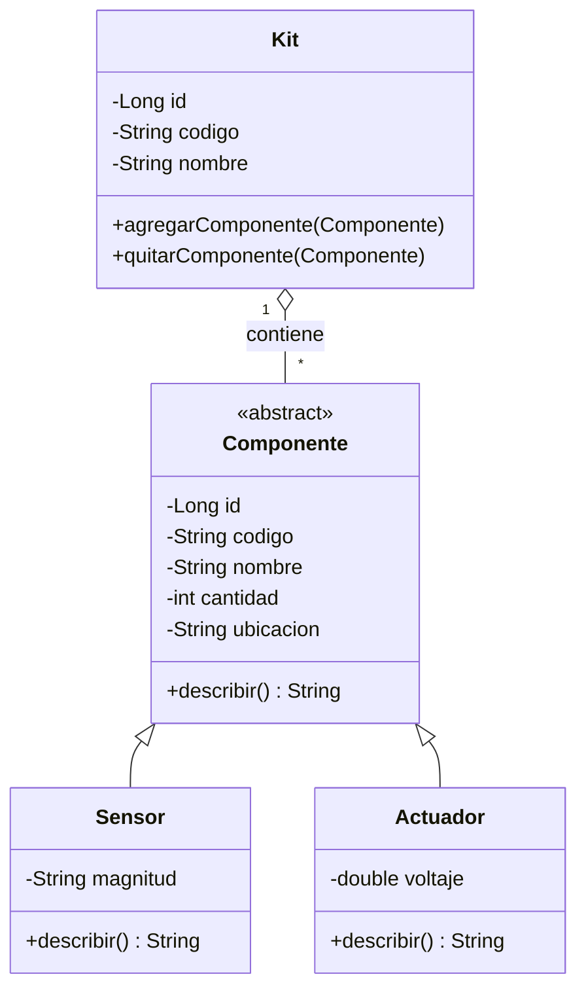
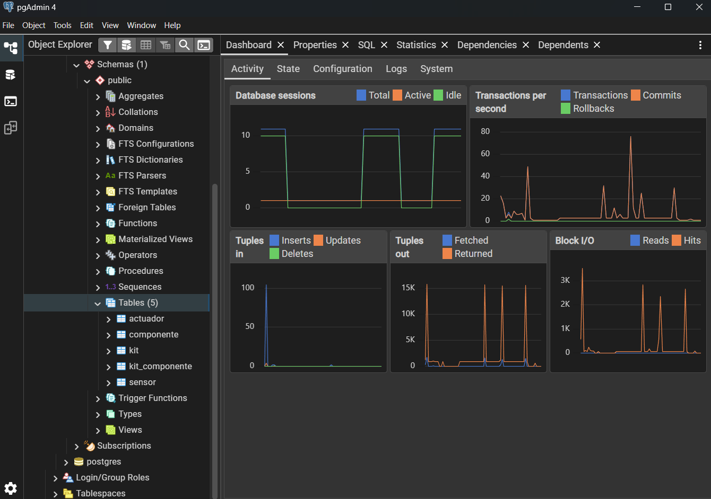
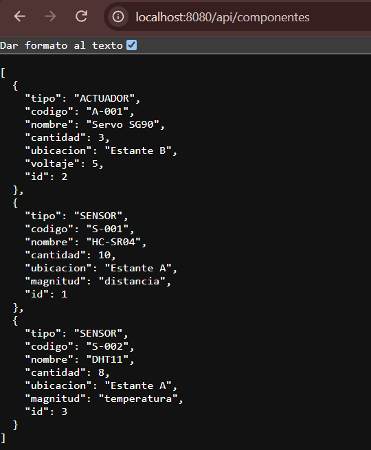
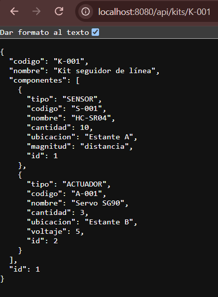
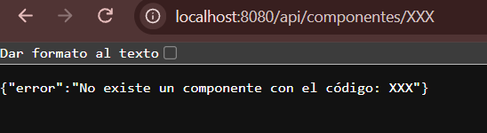
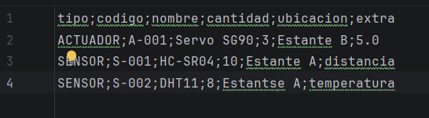

# Inventario del Laboratorio de Mecatrónica

Proyecto final de **Programación y Diseño Orientado a Objetos** (CORHUILA, 2026-B).

**Autores:** Sofía Isabel Mendoza Muñoz - Juan José Mejía


---

## 1. Problema

En un laboratorio de mecatrónica y robótica se manejan muchos componentes pequeños (sensores, servomotores, microcontroladores) que se guardan en estantes distintos. Sin un registro ordenado es difícil saber **qué hay, cuántas unidades quedan, dónde está cada cosa y qué componentes forman cada kit de práctica**.

Este proyecto es una API en Java que permite llevar ese inventario:

- Registrar, consultar, actualizar y eliminar componentes (**CRUD**).
- Agrupar componentes en **kits** (por ejemplo, "Kit seguidor de línea").
- Detectar los componentes con **poco stock**.
- Guardar los datos en **PostgreSQL** y hacer un **respaldo en archivo CSV**.

## 2. Tecnologías

| Tecnología | Uso |
|---|---|
| Java 25 | Lenguaje |
| Spring Boot 4 (Web MVC, Data JPA, Validation) | Framework |
| PostgreSQL | Base de datos |
| Maven (wrapper incluido) | Construcción del proyecto |
| IntelliJ IDEA | IDE |

## 3. Diseño

### 3.1 Arquitectura por capas

```
com.corhuila.proyecto
 ├── model        -> entidades del dominio (encapsuladas)
 ├── repository   -> acceso a datos (PostgreSQL y archivo CSV)
 ├── service      -> lógica de negocio y reglas
 ├── controller   -> peticiones HTTP (GET, POST, PUT, DELETE)
 └── exception    -> excepciones propias y su manejo
```

Cada capa tiene una sola responsabilidad: el **controlador** recibe la petición, el **servicio** aplica las reglas y el **repositorio** se comunica con el almacenamiento. Así, cambiar la forma de guardar los datos no obliga a tocar el modelo ni los controladores.

### 3.2 Diagrama de clases



### 3.3 Cómo se aplican los pilares de la POO

| Pilar / requisito | Dónde se aplica | Decisión |
|---|---|---|
| **Encapsulamiento** | `Componente`, `Sensor`, `Actuador`, `Kit` | Atributos `private` y *setters* que validan (invariantes): el código y el nombre no pueden estar vacíos, la cantidad no puede ser negativa, el voltaje debe ser mayor que 0. El kit expone su lista como solo lectura y se modifica únicamente con `agregarComponente` y `quitarComponente`. |
| **Abstracción** | `Componente` (clase abstracta) | Representa lo común a cualquier componente. No tiene sentido crear un "componente genérico", solo sus tipos concretos. |
| **Herencia** | `Sensor` y `Actuador` extienden `Componente` | Relación "es un". Reutilizan los datos y validaciones del padre y agregan los suyos (magnitud, voltaje). |
| **Polimorfismo** | `describir()` | Cada tipo describe a su manera. El servicio recorre una `List<Componente>` y llama a `describir()` sin saber el tipo concreto (`GET /api/componentes/descripciones`). |
| **Composición** | `Kit` contiene una lista de `Componente` | Relación "tiene un". Un kit agrupa componentes y un componente puede estar en varios kits. |
| **Colecciones** | `List<Componente>` en `Kit` y en los listados | Se usa `List` porque la operación dominante es recorrer y mostrar los elementos. La búsqueda por código la resuelve la base de datos con `findByCodigo` y un índice único. |
| **Excepciones** | Paquete `exception` | Excepciones propias: `ComponenteNoEncontradoException`, `ComponenteDuplicadoException`, `KitNoEncontradoException`, `ArchivoCsvException`. Un manejador central las convierte en respuestas HTTP claras. |
| **Persistencia** | `ComponenteRepository`, `KitRepository`, `ComponenteCsvRepository` | PostgreSQL como almacenamiento principal y archivo CSV como respaldo, ambos aislados en repositorios. |
| **Sin números mágicos** | `application.properties` | El stock mínimo (`inventario.stock.minimo`) y la ruta del CSV (`respaldo.ruta`) son propiedades, no valores escritos en el código. |

## 4. Cómo ejecutarlo

### 4.1 Requisitos

- JDK 25
- PostgreSQL instalado y encendido

### 4.2 Base de datos

Crear una base de datos vacía llamada `inventario_mecatronica`:

```sql
CREATE DATABASE inventario_mecatronica;
```

Las tablas las crea Spring automáticamente al arrancar (`spring.jpa.hibernate.ddl-auto=update`).

### 4.3 Configuración

En `src/main/resources/application.properties`, poner tus datos de conexión:

```properties
spring.datasource.url=jdbc:postgresql://localhost:5432/inventario_mecatronica
spring.datasource.username=TU_USUARIO
spring.datasource.password=TU_CONTRASEÑA

spring.jpa.hibernate.ddl-auto=update
spring.jpa.show-sql=true

inventario.stock.minimo=5
respaldo.ruta=respaldo/componentes.csv
```

### 4.4 Ejecutar

Desde IntelliJ, ejecutar `ProyectoApplication`, o desde la terminal:

```
.\mvnw.cmd spring-boot:run
```

La API queda en `http://localhost:8080`.

## 5. Endpoints

### Componentes (`/api/componentes`)

| Método | Ruta | Qué hace |
|---|---|---|
| GET | `/api/componentes` | Lista todos los componentes |
| GET | `/api/componentes/{codigo}` | Busca un componente por código |
| GET | `/api/componentes/bajo-stock` | Lista los que tienen menos unidades que el stock mínimo |
| GET | `/api/componentes/descripciones` | Descripción de cada componente (polimorfismo) |
| POST | `/api/componentes` | Crea un componente |
| PUT | `/api/componentes/{codigo}` | Actualiza un componente |
| DELETE | `/api/componentes/{codigo}` | Elimina un componente |

### Kits (`/api/kits`)

| Método | Ruta | Qué hace |
|---|---|---|
| GET | `/api/kits` | Lista los kits con sus componentes |
| GET | `/api/kits/{codigo}` | Busca un kit por código |
| POST | `/api/kits` | Crea un kit |
| POST | `/api/kits/{codigoKit}/componentes/{codigoComponente}` | Agrega un componente al kit |
| DELETE | `/api/kits/{codigoKit}/componentes/{codigoComponente}` | Quita un componente del kit |
| DELETE | `/api/kits/{codigo}` | Elimina un kit |

### Respaldo (`/api/respaldo`)

| Método | Ruta | Qué hace |
|---|---|---|
| POST | `/api/respaldo/exportar` | Guarda todos los componentes en el CSV |
| POST | `/api/respaldo/importar` | Carga el CSV y agrega los componentes que no existían |

### Ejemplos de peticiones (PowerShell)

Crear un sensor (el campo `tipo` indica si es `SENSOR` o `ACTUADOR`):

```powershell
Invoke-RestMethod -Method Post -Uri http://localhost:8080/api/componentes -ContentType "application/json" -Body '{"tipo":"SENSOR","codigo":"S-001","nombre":"HC-SR04","cantidad":10,"ubicacion":"Estante A","magnitud":"distancia"}'
```

Crear un actuador:

```powershell
Invoke-RestMethod -Method Post -Uri http://localhost:8080/api/componentes -ContentType "application/json" -Body '{"tipo":"ACTUADOR","codigo":"A-001","nombre":"Servo SG90","cantidad":3,"ubicacion":"Estante B","voltaje":5.0}'
```

Crear un kit y agregarle un componente:

```powershell
Invoke-RestMethod -Method Post -Uri http://localhost:8080/api/kits -ContentType "application/json" -Body '{"codigo":"K-001","nombre":"Kit seguidor de linea"}'
Invoke-RestMethod -Method Post -Uri http://localhost:8080/api/kits/K-001/componentes/S-001
```

Las peticiones GET también se pueden abrir directamente en el navegador, y todas se pueden probar con Postman.

## 6. Manejo de errores

| Situación | Excepción | Respuesta |
|---|---|---|
| Código de componente inexistente | `ComponenteNoEncontradoException` | 404 |
| Código de kit inexistente | `KitNoEncontradoException` | 404 |
| Crear un componente con código repetido | `ComponenteDuplicadoException` | 409 |
| Borrar un componente que está dentro de un kit | `DataIntegrityViolationException` | 409 |
| Datos inválidos (cantidad negativa, nombre vacío...) | `IllegalArgumentException` | 400 |
| Archivo CSV inexistente o con una línea inválida | `ArchivoCsvException` | 400 |

Todas devuelven un JSON con el mensaje, por ejemplo: `{"error": "No existe un componente con el código: XXX"}`.

## 7. Persistencia en archivo (CSV)

`ComponenteCsvRepository` es la única clase que lee y escribe el archivo. Maneja las `IOException` y valida cada línea al cargar usando los mismos constructores con validaciones del modelo. Formato del archivo (separador `;`):

```
tipo;codigo;nombre;cantidad;ubicacion;extra
SENSOR;S-001;HC-SR04;10;Estante A;distancia
ACTUADOR;A-001;Servo SG90;3;Estante B;5.0
```

La columna `extra` guarda la magnitud (sensores) o el voltaje (actuadores).

## 8. Capturas

> Reemplaza estas líneas con tus capturas (guárdalas en una carpeta `docs/` del repositorio).

**Tablas creadas en PostgreSQL**



**Listado de componentes**



**Kit con sus componentes**



**Error 404 con excepción propia**



**Archivo CSV de respaldo**



## 9. Aprendizajes y mejoras

- Diseñar primero las clases y sus relaciones hizo mucho más simple implementar cada capa.
- Separar controlador, servicio y repositorio permitió agregar el respaldo CSV sin modificar el modelo.
- **Mejoras posibles:** préstamos de componentes con fecha de devolución, alertas automáticas de bajo stock, validaciones con `@Valid` y un menú o interfaz gráfica.
